# Hi, I'm Carlos 👋

**Data Engineer** · [@cmoreyra09](https://github.com/cmoreyra09)

I love turning messy data into something people can actually trust. My thing is designing **robust data architectures**: pipelines that don't break at 3 a.m., models that scale, and integrations that just work.

Always curious, always tinkering. If there's a new tool in the data world, I'm probably already trying it out. ☕

Data Integration &nbsp;·&nbsp; Pipelines &nbsp;·&nbsp; Automation &nbsp;·&nbsp; Analytics

 

##  Languages I've Learned

  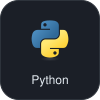
  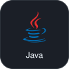
  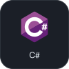
  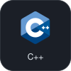
  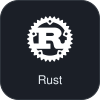
  

##  My Work Environment

**Editor & Terminal**

  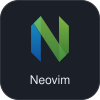
  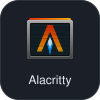
  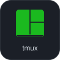

**Operating Systems**

  
  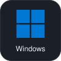
  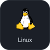

**Organization & Documentation**

  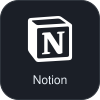

##  Databases

**Relational**

  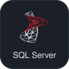
  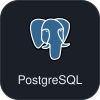
  
  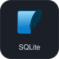

**Administration**

  

**NoSQL** · up next on my learning path

  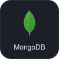

##  Frameworks & APIs

  
  
  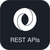

##  Orchestration & Containers

  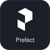
  
  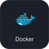

##  Cloud & Data Platforms

  
  
  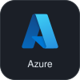
  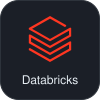

##  Analytics & Visualization

  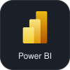

##  Algorithm Practice

I sharpen my problem-solving on **LeetCode**: arrays, strings, hash maps, recursion. I document what I learn from every exercise along the way.

##  Projects

- **[API Integrations](https://github.com/cmoreyra09/projects-api)**: Python pipelines organized by source, plus SQL queries.
- **[Freshservice API](https://github.com/cmoreyra09/Fresh-Service---Datamart)**: Bruno requests and endpoint documentation for the Freshservice REST API.

##  Documentation

- **[Freshservice API Guide](https://github.com/cmoreyra09/Fresh-Service---Datamart)**: endpoints, pagination, and usage examples.

 

Thanks for stopping by! Feel free to explore the repos. ✨

